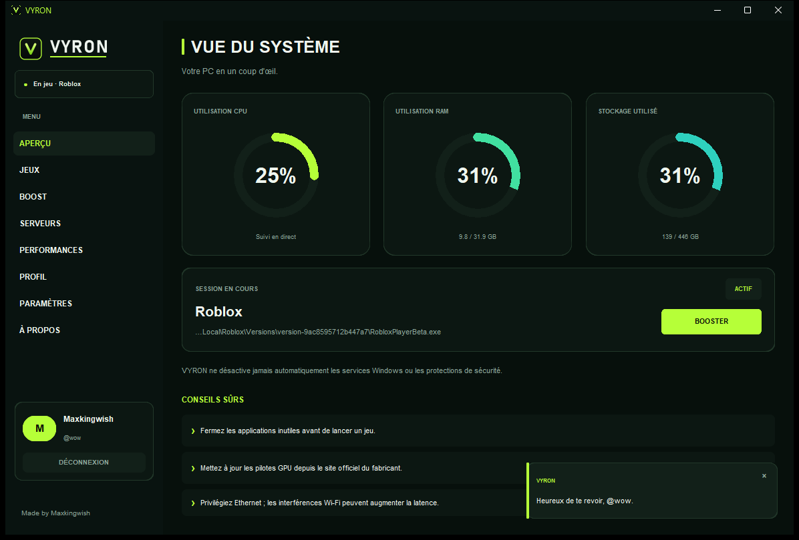
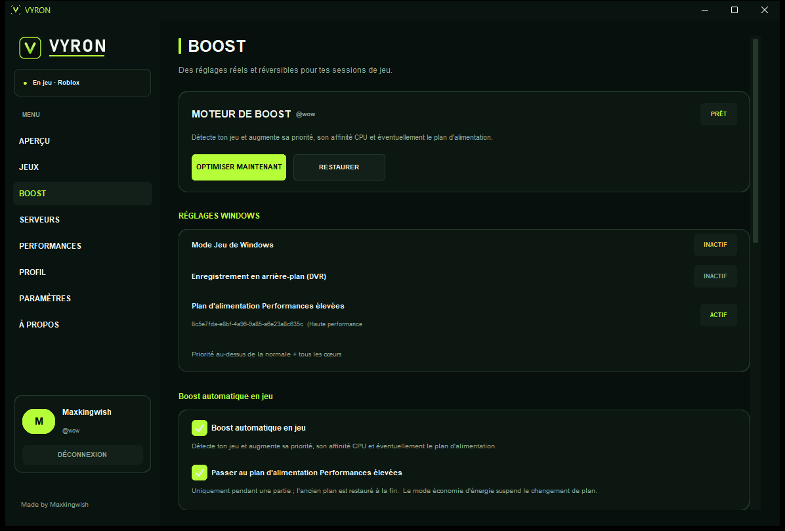
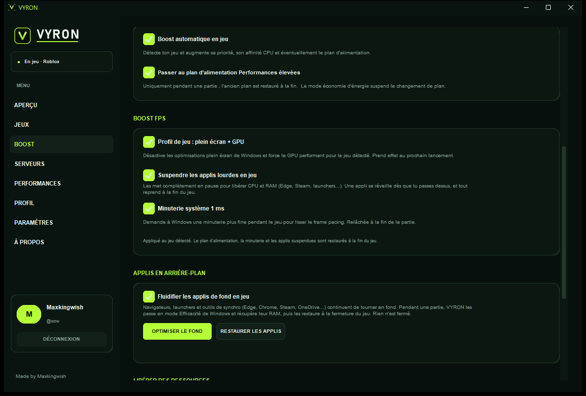
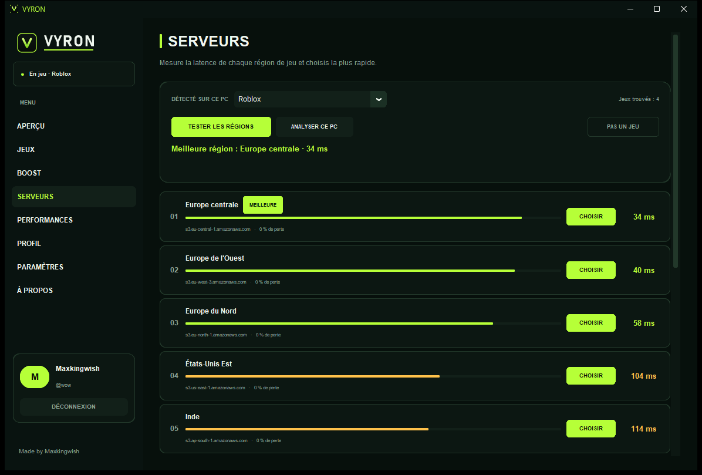
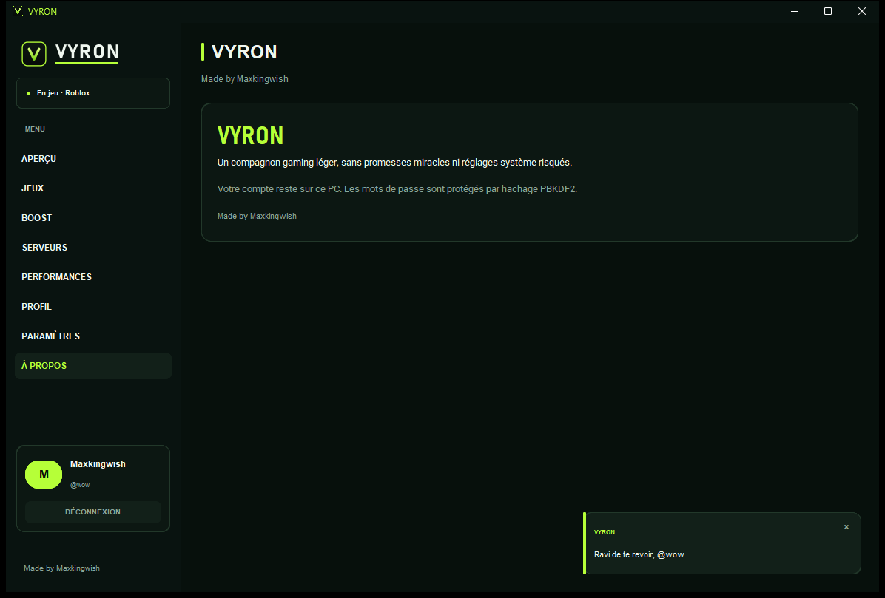

<div align="center">


**Un compagnon de jeu Windows léger qui libère vraiment des ressources.**

[](#installation)
[](https://www.python.org/downloads/)
[](LICENSE)
[](README.md#confidentialité)

[English](README.md) · **Français**

</div>



VYRON détecte le jeu que tu lances, lui rend du CPU et de la RAM, applique de
vrais réglages de performance Windows — et annule chacun d'eux quand tu arrêtes
de jouer. Pas de compte en ligne, pas de télémétrie, pas de droits
administrateur, pas de fenêtre de console.

**Made by Maxkingwish** · [Règles d'attribution](ATTRIBUTION.md)

## Pourquoi VYRON

La plupart des « boosters » ferment trois processus et s'arrêtent là. VYRON fait
le travail mesurable :

- détecte le jeu tout seul (Steam, Epic, GOG, Xbox, Ubisoft, EA, Riot, jeux autonomes) ;
- passe les navigateurs, launchers et clients de synchro en **mode Efficacité**
  de Windows, vide leur mémoire de travail et peut les **geler** pendant la partie ;
- monte le jeu en priorité Above Normal, avec tous les cœurs et une I/O élevée ;
- désactive les optimisations plein écran et sélectionne le GPU performant pour
  ce jeu ;
- demande à Windows une **minuterie 1 ms** pour stabiliser le frame pacing ;
- restaure priorités, RAM, valeurs de registre, plan d'alimentation et minuterie
  à la sortie du jeu — et même après un crash.

## Fonctionnalités

### Détection des jeux
Détection automatique façon Discord, par nom d'exécutable ou dossier
d'installation, affichée dans la barre latérale, sur l'Aperçu et dans le Game
Center. Un sélecteur manuel « choisir une app en cours » reste disponible, et les
faux positifs peuvent être ignorés avec **Pas un jeu** (restaurable dans
Paramètres).

### Boost FPS (réversible)
- **Profil de jeu** — optimisations plein écran désactivées, GPU performant,
  upgrade de swap-effect DXGI. Par jeu, `HKCU` uniquement, avec la valeur
  d'origine sauvegardée.
- **Applis en arrière-plan** — regroupées comme le Gestionnaire des tâches
  (`Microsoft Edge · 14 processus · 810 Mo`) avec **Optimiser** (mode Efficacité
  + priorité Below Normal + nettoyage de la mémoire) et **Fermer** (confirmation
  d'abord).
- **Suspendre les applis lourdes en jeu** — les gèle complètement ; l'appli sur
  laquelle tu passes se réveille en moins d'une seconde. Tout reprend à la sortie
  du jeu. Une appli gelée est notée sur disque : même un kill forcé est réparé au
  prochain démarrage.
- **Minuterie système 1 ms** — demandée pendant la partie, relâchée après.
- **Réglage du processus du jeu** — priorité Above Normal, tous les cœurs, I/O
  haute, et jamais en mode Efficacité.

### Surveillance
Anneaux CPU, RAM et stockage en direct ; usage et température du GPU NVIDIA via
`nvidia-smi` (mis en cache et interrogé seulement quand la page Performances est
visible).

### Serveurs
Teste les régions de référence cloud en parallèle sur TCP/443 et les classe de la
plus rapide à la plus lente, avec perte de paquets et états inaccessibles.
**Il mesure l'aller-retour vers des points de référence, pas vers le serveur de
ton jeu, et VYRON ne crée pas de tunnel VPN.** Choisir une région enregistre
seulement ta préférence.

### Comptes et bibliothèque
Comptes locaux uniquement : PBKDF2-HMAC-SHA256 + sel aléatoire, aucun réseau.
Bibliothèque de jeux par compte avec lancement en un clic. Le mode invité marche
pour tout sauf le moteur de boost.

### Six langues
Anglais, français, russe, italien, espagnol, portugais — changeables à tout
moment.

## Le boost, honnêtement

| Réglage | Portée | Restauré par |
| --- | --- | --- |
| Mode Jeu, DVR et capture désactivés | `HKCU` | **Restaurer**, sortie de jeu, fermeture |
| Plan Performances élevées | seulement en jeu, jamais sur batterie | sortie de jeu, fermeture |
| Priorité / affinité / I-O du jeu | processus du jeu | sortie de jeu |
| Profil plein écran + GPU | un jeu, `HKCU` | **Restaurer** ou désactivation de l'option |
| Minuterie 1 ms | processus | sortie de jeu, fermeture |
| Applis bridées | processus utilisateur | sortie de jeu, **Restaurer les applis**, fermeture, `atexit` |
| Applis gelées | processus utilisateur | idem + prochain démarrage après un crash |

VYRON ne désactive jamais les services de sécurité, n'utilise jamais la priorité
`REALTIME`, ne tue jamais un processus automatiquement et n'écrit rien en dehors
de `HKCU` ou du dossier de l'utilisateur. Les gains dépendent du matériel, des
pilotes, des températures et de ce qui tournait en fond ; aucun outil ne peut
promettre un nombre de FPS fixe.

## Captures d'écran

| Moteur de boost | FPS et applis de fond |
| --- | --- |
|  |  |

| Latence des régions | |
| --- | --- |
|  | |

## Installation

### Option A — exécutable prêt à l'emploi
Télécharge `VYRON.exe` depuis les Releases et lance-le. Aucun Python nécessaire.

> L'exécutable n'est pas signé : SmartScreen peut prévenir la première fois.
> Clique sur **Informations complémentaires → Exécuter quand même**, ou compile-le
> toi-même depuis les sources.

### Option B — scripts en un clic (depuis les sources)
1. Installe [Python 3.10+](https://www.python.org/downloads/) en cochant
   **Add Python to PATH**.
2. Double-clique sur **`VYRON.vbs`** — lancement silencieux, sans console. Il
   installe les deux dépendances au premier lancement si besoin.
3. `INSTALL_VYRON.bat` affiche la sortie d'installation en cas de problème ;
   `RUN_VYRON.bat` est un raccourci vers le lanceur silencieux.

### Option C — manuel
```powershell
git clone https://github.com/maxkyngwish/VYRON.git
cd VYRON
py -m venv .venv
.\.venv\Scripts\Activate.ps1
python -m pip install -r requirements.txt
python main.py
```

### Compiler l'exécutable
```powershell
BUILD_VYRON_EXE.bat
```
ou
```powershell
python -m pip install pyinstaller
pyinstaller --noconfirm --clean --onefile --windowed --name VYRON ^
  --icon "vyron\assets\vyron.ico" ^
  --add-data "vyron\assets;vyron\assets" --collect-all customtkinter main.py
```
Résultat : `dist\VYRON.exe` (icône de fenêtre et de barre des tâches incluse, pas
de console).

## Ce que VYRON écrit sur ton PC

| Chemin | Contenu |
| --- | --- |
| `%USERPROFILE%\.vyron_settings.json` | langue, session mémorisée, préférences de boost |
| `%USERPROFILE%\.vyron_accounts.json` | comptes locaux (hashes PBKDF2) et bibliothèques |
| `%USERPROFILE%\.vyron_suspended.json` | applis gelées, pour la récupération après crash |
| `%USERPROFILE%\.vyron_crash.log` | erreurs de démarrage uniquement |
| `HKCU\Software\Microsoft\GameBar` | Mode Jeu, restauré par **Restaurer** |
| `HKCU\System\GameConfigStore` + `...\GameDVR` | DVR/capture, restaurés par **Restaurer** |
| `HKCU\...\AppCompatFlags\Layers` | indicateur plein écran, par jeu |
| `HKCU\Software\Microsoft\DirectX\UserGpuPreferences` | préférence GPU et swap-effect, par jeu |

Rien n'est envoyé nulle part. Supprime les quatre fichiers ci-dessus pour
réinitialiser VYRON complètement.

## Confidentialité

- Aucune télémétrie, aucun analytics, aucun compte distant, aucun ping de mise à
  jour.
- Seul trafic réseau : les tests de latence que tu lances, le test de ping
  optionnel, et le trafic de tes jeux.
- Comptes et réglages ne quittent jamais la machine.

## Structure du projet

```
main.py                 point d'entrée et dialogue d'erreur
vyron/
  app.py                interface, pages, polling, câblage
  boost.py              registre, plan d'alimentation, minuterie, profil de jeu
  trim.py               applis de fond : groupes, bridage, suspension, restauration
  detection.py          détection des jeux et exclusions
  system_info.py        snapshot léger, GPU en cache, ping
  servers.py            régions et tests de latence concurrents
  accounts.py           comptes locaux et bibliothèques
  i18n*.py              chaînes en six langues
  processes.py          énumération des fenêtres/processus
  assets/               logo, wordmark et icône
tools/
  make_assets.py        régénère les images de marque
  check_attribution.py  protège la mention « Made by Maxkingwish »
docs/screenshots/       images du README
```

Dépendances d'exécution : **CustomTkinter** et **psutil** uniquement. Tout le
reste est la bibliothèque standard Python, et VYRON se place lui-même en priorité
Below Normal pour ne jamais concurrencer le jeu.

## Dépannage

| Symptôme | Solution |
| --- | --- |
| Rien ne se passe au double-clic | Lance `INSTALL_VYRON.bat` pour voir l'erreur, ou `python main.py` dans un terminal. |
| « Python 3.10 ou plus est requis » | Réinstalle Python en cochant **Add Python to PATH**. |
| Certains réglages sont partiels / demandent admin | VYRON est conçu pour un utilisateur standard ; les réglages restants nécessitent une session élevée et sont ignorés proprement. |
| Le jeu n'est pas détecté | Utilise **Game Center → choisir une app en cours**, ou ajoute le jeu manuellement. |
| Une appli de fond semble lente | Boost → **Restaurer les applis**, ou décoche *Suspendre les applis lourdes*. |
| Erreur au démarrage | Voir `%USERPROFILE%\.vyron_crash.log`. |

## FAQ

**Est-ce que ça augmente vraiment les FPS ?**
Ça supprime de vrais freins : contention CPU/RAM en fond, composition plein
écran, granularité de la minuterie et choix du GPU. Le gain dépend du PC et de ce
qui tournait. VYRON reste honnête et ne promet jamais un chiffre fixe.

**Faut-il être administrateur ?**
Non. Tout est par utilisateur (`HKCU`, priorités de processus). Les rares
réglages qui exigeraient admin sont ignorés avec un message clair.

**Est-ce que ça ferme mes applis ?**
Jamais automatiquement. **Fermer** demande toujours confirmation. L'optimiseur
ne fait que ralentir ou geler, puis restaure.

**Peut-on tout annuler ?**
Oui : **Restaurer** sur la page Boost, la sortie du jeu, ou la fermeture de
VYRON. Même un crash est récupéré au démarrage suivant.

**Mes données sont-elles envoyées ?**
Non. Les comptes sont locaux, hachés en PBKDF2-HMAC-SHA256.

## Contribuer

Les issues et pull requests sont bienvenues. Lis [AGENTS.md](AGENTS.md) (règles du
projet) et lance :

```powershell
py -m compileall -q vyron tools main.py
py tools/check_attribution.py
```

La mention **Made by Maxkingwish** doit rester visible et inchangée partout — voir
[ATTRIBUTION.md](ATTRIBUTION.md). Cela vaut aussi pour les forks et les
changements générés par IA.

## Crédits et attribution

Créé et maintenu par **Maxkingwish**.

La mention `Made by Maxkingwish` est protégée : elle ne peut être ni supprimée, ni
traduite, ni raccourcie, ni cachée, ni recouverte. Détails et vérification :
[ATTRIBUTION.md](ATTRIBUTION.md) · `tools/check_attribution.py`.



Construit avec [CustomTkinter](https://github.com/TomSchimansky/CustomTkinter) et
[psutil](https://github.com/giampaolo/psutil).

## Licence

[MIT](LICENSE) © 2026 Maxkingwish.
